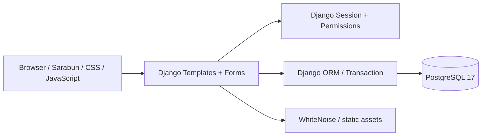
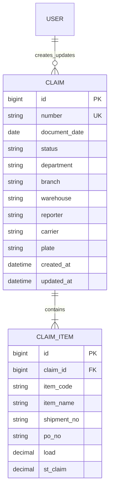

# โครงสร้างและแนวทางพัฒนา

## สถาปัตยกรรม

ใช้ modular monolith เพื่อเริ่มงานได้เร็วและดูแล deployment จุดเดียว แยก `claims` เป็น domain หลัก สามารถเพิ่ม `masterdata`, `approvals`, `attachments`, `reports` เป็น Django apps ภายหลัง โดยยังไม่เพิ่ม service ที่ต้องดูแลโดยไม่มีความจำเป็น

## โครงข้อมูลที่มีแล้ว

Diff เป็นค่าคำนวณ ไม่จัดเก็บซ้ำ ชื่อแผนก สาขา ขนส่ง และผู้อนุมัติยังเป็น snapshot ในเอกสาร เพื่อเก็บรายละเอียดตามเวลาที่กรอก ในรุ่นที่มี master data ให้เพิ่ม foreign key ควบคู่ snapshot ตามนโยบายข้อมูลขององค์กร

## แนวหน้าจอ

- Sidebar สำหรับภาพรวม รายการเคลม สร้างเอกสาร และจัดการระบบ
- Dashboard ใช้การ์ดสรุป 4 ตัวและตารางล่าสุด ไม่แสดงสถิติสมมติ
- ฟอร์มแบ่งส่วนเลข 01–04 ลดความหนาแน่นจากต้นฉบับ; จอเล็กเรียงแนวตั้ง
- ตารางสินค้ารองรับเลื่อนแนวนอน ช่องจำเป็นระบุ * ข้อผิดพลาดแสดงใกล้ช่อง และมีข้อความสรุปเมื่อบันทึกไม่ผ่าน
- น้ำเงินใช้กับ action หลัก ส้มใช้สถานะรอตรวจ แดงใช้ข้อผิดพลาด เขียวใช้สถานะปิดรายการ

## ขั้นต่อไปที่ต้องตกลงกับเจ้าของกระบวนการ

1. ความหมายของ ST claim และกรณีที่มากกว่า Load: รุ่นนี้อนุญาต Diff ติดลบตามสูตรต้นฉบับ
2. ตารางสิทธิ์ Reporter / Reviewer / Approver / Administrator และขอบเขตสาขา
3. เงื่อนไขเปลี่ยนสถานะ ย้อนกลับ ยกเลิก และล็อกเอกสารปิดแล้ว
4. เลขเอกสารรันตามปี/คลัง และการป้องกันเลขซ้ำระหว่าง transaction
5. ClaimEvent สำหรับ audit trail และ optimistic locking ป้องกันแก้ไขทับ
6. หลักฐานไฟล์แนบ: ประเภท/ขนาดไฟล์ retention และ private object storage
7. รายงานยอดเงิน SLA งานเกินกำหนด และการเชื่อม master data จากระบบต้นทาง
